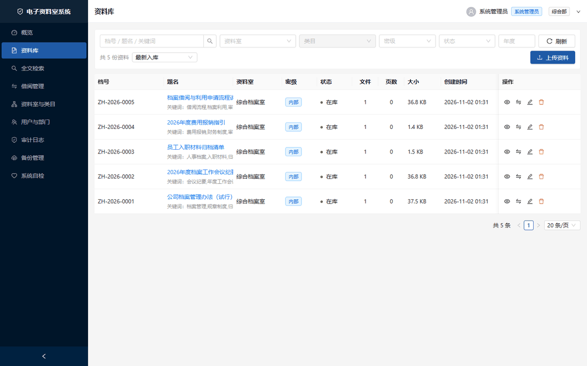
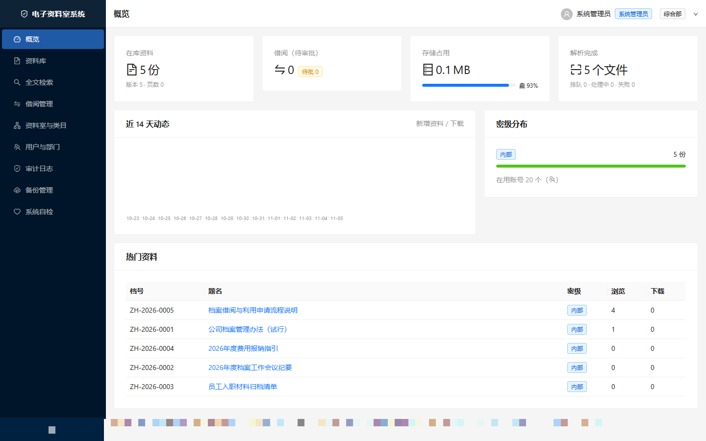
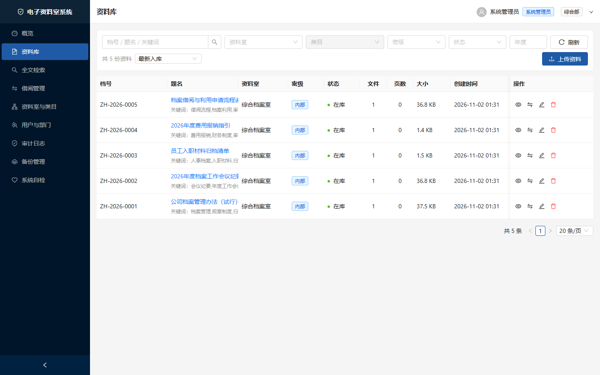
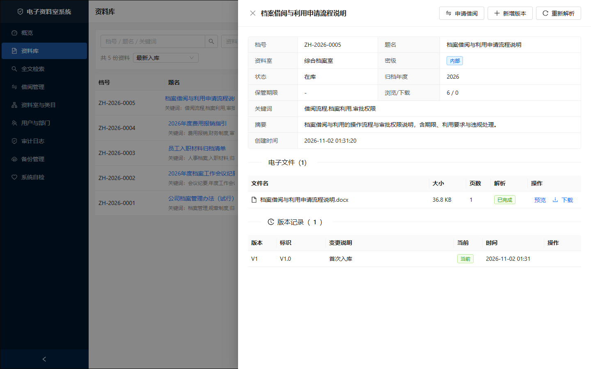
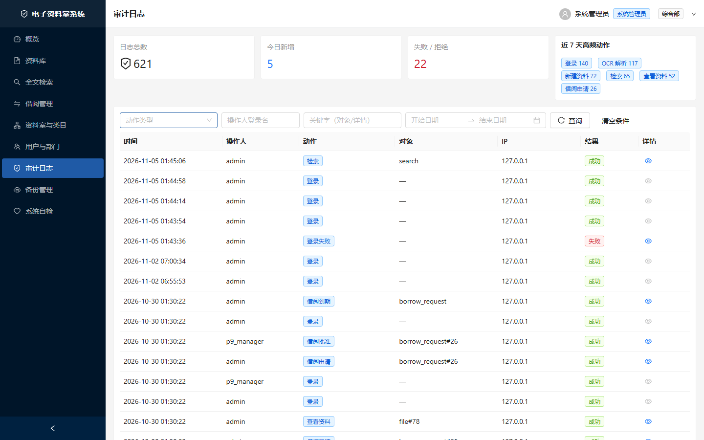
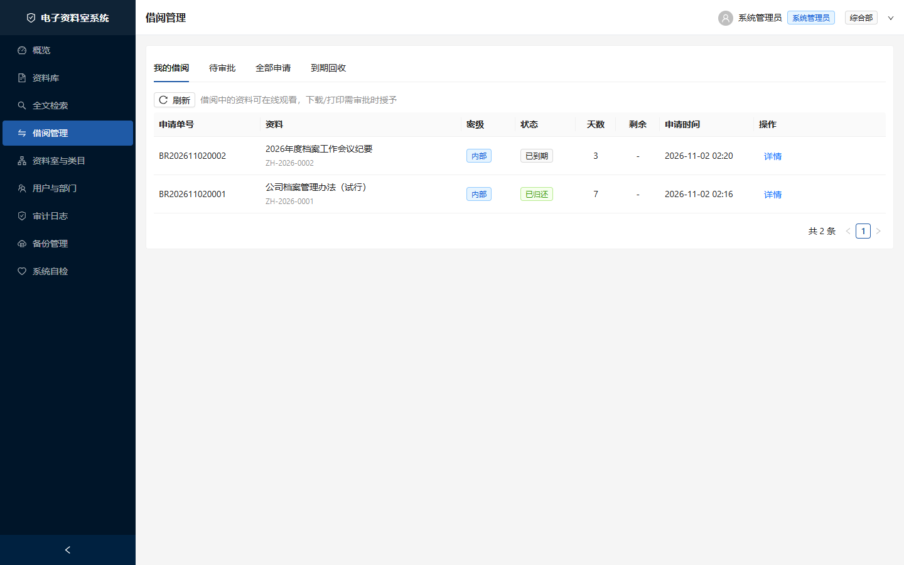
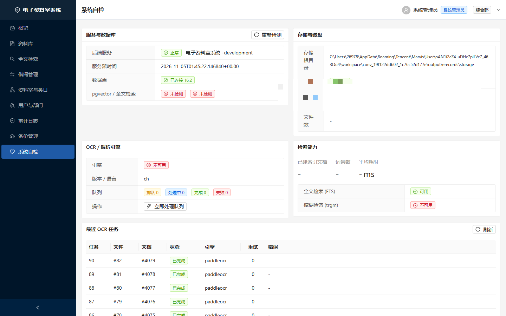

# 电子资料室系统 · Electronic Records Room

[](https://github.com/Leoshebao/electronic-records-room/actions/workflows/ci.yml)
[](LICENSE)
[](https://www.python.org/)
[](https://www.postgresql.org/)
[](https://react.dev/)

> 面向企业内部局域网的离线档案管理系统：四级密级管控、全文检索、借阅审批、版本管理、水印导出与审计追溯。
> An offline-first electronic records management system for corporate LANs: 4-level secrecy control, full-text search, borrowing workflow, versioning, watermark export and audit trail.

纯内网部署 · 免安装便携运行 · 全中文界面 · 10–30 人规模

---

## 界面预览 / Screenshots



| 概览（仪表盘） | 资料库列表 |
|:---:|:---:|
|  |  |

| 档案详情与元数据 | 审计日志 |
|:---:|:---:|
|  |  |

| 借阅管理 | 系统自检 |
|:---:|:---:|
|  |  |

> 截图为便携版本地实例的真实界面（演示数据，非真实档案）。

## 功能特性

| 模块 | 能力 |
|------|------|
| 资料室 | 多资料室（库房）+ 三级类目树，按类目归档 |
| 资料管理 | 上传（PDF/Word/Excel/图片）、UUID 落盘、年月分目录、批量上传、软删除与回收 |
| 密级管控 | 公开 / 内部 / 秘密 / 机密 四级，决定列表可见范围与单条访问权限 |
| 权限模型 | 三类角色（系统管理员 / 档案管理员 / 查阅者）× 14 个权限点，支持资料级例外授权 |
| 全文检索 | 中文 bigram 切分 + 密级过滤 + 类目过滤，目标 2 秒内响应 |
| 文本解析 | PDF 文本层优先，DOCX/XLSX 直读，图片与扫描件走 OCR 异步队列（不阻塞入库） |
| 借阅审批 | 申请 → 审批 → 临时授权 → 到期自动回收，支持归还、续借、撤回 |
| 版本管理 | 多版本上传、版本链、回滚到指定版本 |
| 水印导出 | 动态生成带「用户名 + 时间戳」的水印 PDF，控制外发 |
| 审计 | 全量操作留痕，独立事务写入，数据库触发器保证不可篡改 |
| 备份恢复 | 一键 `pg_dump` + 存储目录打包，按保留天数自动清理 |
| 系统自检 | 数据库、存储、OCR 引擎状态页 |
| 双部署 | Docker Compose 部署 + Windows 纯本地免安装便携版 |

## 技术栈

| 层 | 选型 |
|----|------|
| 后端 | Python 3.11 · FastAPI 0.115 · SQLAlchemy 2.0 · Alembic · Pydantic v2 |
| 数据库 | PostgreSQL 16（唯一主库） |
| 前端 | React 18 · TypeScript 5.7 · Vite 6 · Ant Design 5 · Axios |
| 认证 | JWT（PyJWT）+ bcrypt，首登强制改密，失败锁定 |
| 检索 | PostgreSQL `ILIKE` + 中文 bigram 索引列 |
| 解析 | PyMuPDF / python-docx / openpyxl / PaddleOCR（可选，离线模型） |
| 部署 | Nginx + 自签 TLS（含 IP SAN）或内置预览服务，Windows 便携包内嵌 Python 与 PostgreSQL |

## 架构与目录

```
浏览器 ──HTTP(S)──▶ Nginx / 预览服务 ──/api──▶ FastAPI ──▶ PostgreSQL
                                   │              │
                                   └── 静态 dist   └──▶ storage/（文件落盘）
```

```
.
├── backend/
│   ├── app/
│   │   ├── api/routes/      # 14 个路由模块，69 个端点
│   │   ├── core/            # 配置、安全、权限矩阵
│   │   ├── db/              # 会话、基类
│   │   ├── models/          # 16 张表的 ORM 模型
│   │   ├── schemas/         # 出入参
│   │   └── services/        # 业务逻辑（11 个）
│   ├── alembic/versions/    # 迁移链 0001 → 0005
│   └── scripts/             # 种子、重置、验收、预览服务
├── frontend/
│   ├── src/pages/           # 11 个页面
│   ├── src/api/             # axios 客户端与类型
│   └── public/config.js     # 运行时可改的后端地址
├── deploy/                  # Nginx 配置、证书生成、启停脚本
├── launcher.py              # 便携版启动器（拉起 PG / API / 预览服务）
├── start.bat / stop.bat / status.bat
└── docker-compose.yml
```

## 快速开始

### 方式一：Docker Compose

```bash
cp .env.example .env          # 修改 SECRET_KEY / 数据库密码
docker compose up -d --build
docker compose exec api alembic upgrade head
docker compose exec api python scripts/seed_admin.py --with-samples
# 访问 http://127.0.0.1:8080
```

### 方式二：本地开发

```bash
# 1. 准备数据库（PostgreSQL 14+）
createdb erecords

# 2. 后端
cd backend
python -m venv .venv && .venv\Scripts\activate
pip install -r requirements.txt
copy ..\.env.example ..\.env        # 修改连接信息
alembic upgrade head
python scripts/seed_admin.py --with-samples
uvicorn app.main:app --host 127.0.0.1 --port 8000 --reload

# 3. 前端
cd ../frontend
npm install
npm run dev                         # 开发访问 http://127.0.0.1:5173
npm run build                       # 产物 dist/，由 Nginx 或预览服务托管
```

### 方式三：Windows 便携版（免安装）

仓库不含运行时二进制。自行构建：

1. 准备 `runtime/python`（内嵌 CPython 3.11 + 依赖）与 `runtime/pg`（PostgreSQL 16 便携版）；
2. 前端 `npm run build` 产出 `frontend/dist`；
3. 双击 `start.bat`：首次自动 `initdb` 并初始化数据库，随后拉起 PostgreSQL(4854)、API(8000)、预览服务(8080)；
4. 浏览器访问 `http://127.0.0.1:8080`。

> `launcher.py` 通过 `pg_ctl` 以受限令牌启动 PostgreSQL，避免 Windows 下「管理员权限拒绝」问题；
> 服务以 `DETACHED_PROCESS` 启动，关闭命令行窗口不会中断。

## 默认账号

| 账号 | 初始口令 | 角色 |
|------|---------|------|
| `admin` | `Admin@12345` | sysadmin（首登强制改密） |

> ⚠️ 仅为本地演示默认值。**部署到任何真实环境前，必须修改默认口令与 `SECRET_KEY`**，并在 `.env` 中关闭 `DEBUG`。

## 权限矩阵

| 权限点 | sysadmin | records_manager | viewer |
|--------|:---:|:---:|:---:|
| `doc:view` / `doc:download` / `doc:print` | ✅ | ✅ | ✅ |
| `doc:upload` / `doc:edit` / `doc:delete` | ✅ | ✅ | — |
| `borrow:apply` | ✅ | ✅ | ✅ |
| `borrow:approve` | ✅ | ✅ | — |
| `room:manage` | ✅ | ✅ | — |
| `user:manage` | ✅ | — | — |
| `audit:view` | ✅ | ✅ | — |
| `system:config` / `backup:manage` | ✅ | — | — |

密级上限：sysadmin → 机密；records_manager → 秘密；viewer → 内部。

## 接口

- 统一前缀 `/api`，共 69 个端点；OpenAPI 文档：`http://127.0.0.1:8000/docs`
- 详细字段级文档见仓库内《电子资料室系统_AI协作开发档案》第 9 章

## 项目文档

| 文件 | 内容 |
|------|------|
| [`docs/architecture.md`](docs/architecture.md) | 完整开发档案（19 章）：硬约束、字段级表结构、69 个端点、权限矩阵、业务链路、配置项、已知坑、二次开发手册、分阶段提示词 |
| [`docs/project_map.json`](docs/project_map.json) | 机器可读项目地图：表字段、端点与权限、角色矩阵、端口、已知限制、验收命令（便于 AI 工具直接解析） |
| [`CLAUDE.md`](CLAUDE.md) | 项目开发约定与路由注册纪律 |

## 验收

```bash
cd backend
python scripts/run_all_verify.py          # 各阶段断言验收
python scripts/verify_api_contract.py     # 前端调用 × 后端路由，未匹配必须为 0
python scripts/verify_frontend_api.py     # 端到端接口连通
cd ../frontend && npm run build           # tsc --noEmit 必须 0 错误
```

CI 在每次 push / PR 到 `main` 时自动执行（[`.github/workflows/ci.yml`](.github/workflows/ci.yml)）：

| Job | 步骤 |
|-----|------|
| Backend | 安装依赖 → `compileall` 语法检查 → `verify_api_contract.py` 契约校验 |
| Frontend | `npm ci` → `npm run typecheck`（`tsc --noEmit`）→ `npm run build` |

## 已知限制

- **OCR 引擎默认未随仓库提供**：`paddleocr` 与离线模型需自行安装，缺失时扫描件解析标记为 `skipped`（不影响入库与电子版文本抽取）；
- 便携版仅监听 `127.0.0.1` 明文 HTTP；局域网多终端访问需按 `deploy/` 配置 Nginx + 自签证书（证书须含服务器 IP SAN）；
- 无全局前端错误边界，组件异常会导致整页空白（可按需加 `ErrorBoundary`）；
- 审计表受触发器保护，记录不可修改或删除（设计特性）；
- 演示/验收脚本内含演示口令，仅用于本地测试。

## 路线图

- [ ] 扫描件 OCR 依赖内置化与模型离线分发
- [ ] 全局错误边界与前端监控
- [ ] 检索性能优化（可选 pgvector 语义检索）
- [ ] 批量导入与元数据模板
- [ ] 多因素认证

## 贡献

欢迎 Issue 与 Pull Request。提交前请确保四项验收全部通过，且不引入需要联网调用的依赖。

## 许可

[MIT](LICENSE)

## 声明

本仓库为通用管理系统源码，不含任何真实档案数据。仓库内示例资料（`backend/scripts/demo_files/` 等）均为虚构内容，仅用于演示。
